

  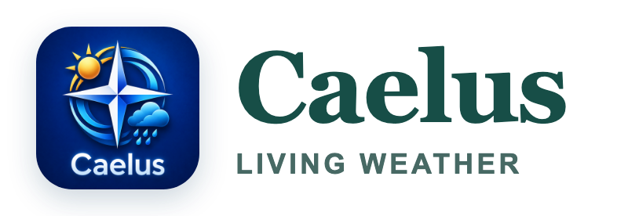

# Caelus User Guide

Caelus is a local weather dashboard and history service for Ecowitt LAN gateways and AcuRite PC Connect USB consoles. It combines current station readings, forecasts, 24-hour metric cards, longer-range graphs, a regional Windy radar map, and observer-local Sun and Moon information in one browser view.

This guide is for day-to-day users. You do not need to understand Python, FastAPI, or SQLite to operate Caelus.

The dashboard overview screenshot was updated from a running Caelus station on October 25, 2026, and includes Feels Like, Wind Chill, and the compact forecast labels. The full-dashboard screenshot was captured on October 19, 2026, before those additions. Other dashboard screenshots, plus the Location and Data & Map settings screenshots, were updated on September 30, 2026. The Station screenshots were updated on October 28, 2026, using the current interface with controlled example data; they do not represent a live hardware validation. Other screenshots, including the Mobile Operation graphics, were captured on September 9, 2026. The Location and Station screenshots use example coordinates and a documentation-only gateway address; enter your own values during setup. Your location, readings, gateway model, forecast, lunar view, and available metrics will differ.

## Open Caelus

Caelus requires Python 3.11 or newer. If upgrading from Python 3.10, install a supported Python version and follow the [environment-upgrade steps in the README](../README.md#source-development) before updating Caelus.

Start Caelus with the launcher created by the installer, then open one of these addresses:

- On the Caelus computer: `http://127.0.0.1:8767`
- From another device on the same trusted network: `http://<Caelus-computer-LAN-IP>:8767`

The usual installed launchers are `/Users/<name>/Caelus/run_caelus.sh` on macOS, `/home/<name>/Caelus/run_caelus.sh` on Linux or Raspberry Pi, and `C:\Users\<name>\Caelus\run_caelus.cmd` on Windows.

The top of the dashboard shows the station name, the time of the last stored observation, and station status. **Station reporting** means Caelus is receiving usable observations. **Station offline** means the selected station is unavailable, disabled, or no longer reporting fresh observations.

## Station selection

The station selector above current readings chooses **Ecowitt** or **AcuRite USB**. Each station has separate current readings, graphs, and exports.
Both connections may run simultaneously. Location, forecast, appearance, and
retention settings are shared. Each browser tab keeps its station in the URL.

**Settings > Station** contains independently expandable connection sections.
Select either station heading to expand or collapse its controls; both start
collapsed, and both can remain open at the same time. Each section has its own
enable control, connection status, history interval, and Save button. AcuRite
connects by USB to the same Raspberry Pi, Linux PC, Mac, or Windows PC running
Caelus; see the
[AcuRite setup and validation guide](acurite_usb.md).

## Quickstart Station Setup

Open **Settings > Station** and expand the connection you want to configure.
You can enable either station or both; their readings and histories stay separate.

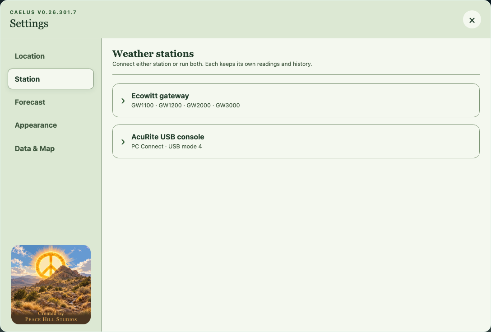

### Ecowitt gateway

Caelus supports GW1100, GW1200, GW2000, and GW3000 primary weather readings.
See the [gateway compatibility details](weather_adapters.md#ecowitt-gateway-compatibility)
for measurement coverage and validation status.

1. Connect the gateway to your LAN using its supported Wi-Fi or Ethernet
   connection. Pair the weather array or individual weather sensors using
   Ecowitt's interface, and confirm live readings there first.
2. Give the gateway a stable LAN address, preferably with a DHCP reservation.
3. Expand **Ecowitt gateway** in Station settings and select **Enabled**.
4. Enter the gateway's HTTP base URL, such as `http://192.168.1.100`.
5. Select **Find Sensors** to review the gateway model and paired inventory.
6. Set **History interval** from 60 to 3600 seconds, then select **Save Gateway**.

### AcuRite USB console

1. Connect a supported AcuRite PC Connect console by USB to the computer running Caelus, and confirm
   the console receives its outdoor array.
2. Complete the platform-specific USB setup described in the
   [AcuRite USB guide](acurite_usb.md). Standard installers include the Python
   USB libraries; Linux additionally offers administrator-authorized device access.
3. Expand **AcuRite USB console**, choose **Console model**, and follow its mode-4
   instructions. For 01025, 01035, 01036, 01525, and 02032 families, select USB or
   PC Connect mode **4** on the console. The 01536-RX uses mode 4 automatically.
   Then select **Enabled**.
4. Leave **USB serial number** blank when one matching console is connected.
   Use an actual serial descriptor to select among multiple matching consoles.
5. Set **History interval** from 60 to 3600 seconds, then select **Save AcuRite**.
6. Check the connection status. Allow a USB sampling cycle and a history interval
   for the first saved observation, then choose **AcuRite USB** above current
   readings on the dashboard.

To stop collecting from either connection, clear its **Enabled** checkbox and
select that section's Save button. Its existing history remains available.

## Settings

Select the **Settings gear** to the right of the Caelus title to open Settings. The Location pane opens first, and the dialog header shows the Caelus version. Each pane saves independently. A save in one pane does not submit unsaved edits from another pane.

The dialog supports mouse, touch, and keyboard navigation. Closing without saving restores an unsaved theme preview. Saved settings refresh the dashboard automatically while keeping the current pane open and preserving unsaved edits in other panes. Action and warning messages appear as toasts at the top center of the dialog and disappear after five seconds.

### Station

The **Ecowitt gateway** and **AcuRite USB console** headings independently expand
or collapse their controls. Use a mouse or touch, or focus a heading and press
Enter or Space. Both sections start collapsed. Scroll within the pane to reach lower controls.
Expanding a section does not
enable collection; changes take effect when you select that section's Save button.

#### Ecowitt gateway controls

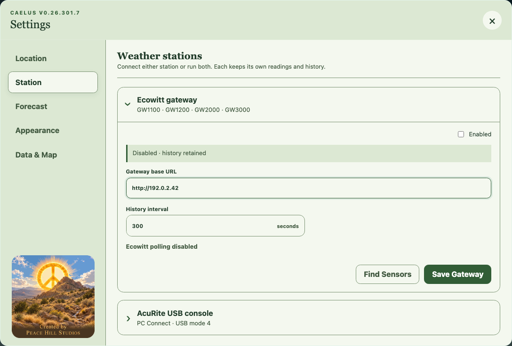

- **Enabled** starts or stops Ecowitt collection when saved.
- **Gateway base URL** is the local HTTP base address, without a path, query,
  embedded credentials, or fragment. The screenshot uses the example address
  `http://192.0.2.42`; enter your gateway's actual LAN address.
- **History interval** accepts 60 to 3600 seconds for this station's polling
  and saved observations.
- **Find Sensors** queries the gateway and displays its model and paired inventory.
- **Save Gateway** validates and saves an enabled connection, then attempts its
  first observation. You can save directly; Find Sensors lets you review the
  discovery first. A disabled connection can be saved without contacting the gateway.

Caelus reads Ecowitt's LAN endpoints. Pair sensors and configure the gateway
through Ecowitt's own interface. Caelus does not configure cloud upload,
custom-server push, MQTT, irrigation, or switches.

#### AcuRite USB controls

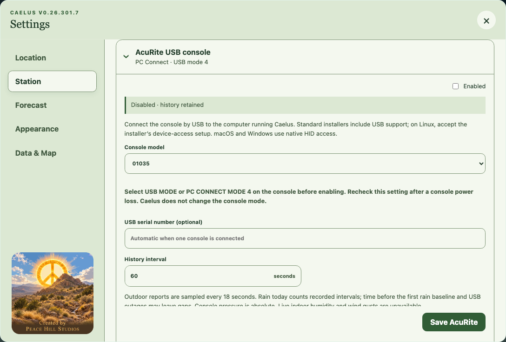

- **Enabled** starts or stops AcuRite collection when saved.
- **Console model** selects the supported console family and displays its USB
  mode instructions. Set mode 4 on the console for families with a mode menu,
  and recheck it after a console power loss.
- **USB serial number (optional)** selects a particular console. Leave it blank
  for automatic selection when only one matching device is connected.
- **History interval** accepts 60 to 3600 seconds for saved observations. Outdoor
  USB reports are sampled every 18 seconds independently of this interval.
- **Save AcuRite** saves only this connection's settings. The status line reports
  whether collection is disabled, waiting for a connection or outdoor sensors,
  receiving fresh observations, or encountering an access/decoding problem.

The console must be attached to the
computer running Caelus. Console pressure is displayed as **Absolute pressure**.
**Recorded rain today** counts recorded intervals and can have gaps before the
first baseline or during outages. Live indoor humidity and wind gusts are
unavailable. See the [USB setup and console validation guide](acurite_usb.md)
for platform permissions, decoding limits, and report capture.

Both connections can run at the same time. Saving one does not submit unsaved
changes in the other. A failed fetch does not erase the station's last stored
observation; check its status and observation time for freshness. Each station's
current readings, graphs, and downloads follow the dashboard's station selector.

### Location

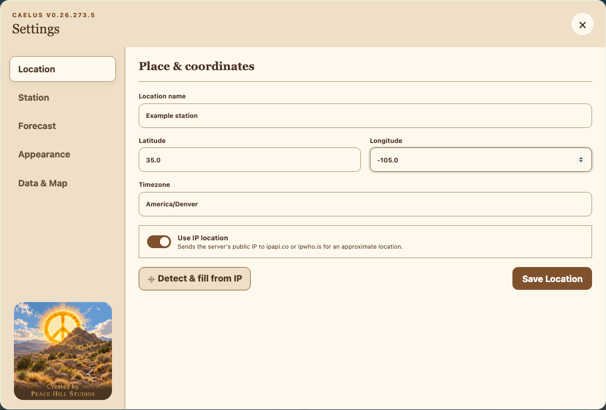

- **Location name** is the dashboard heading.
- **Latitude** accepts -90 through 90.
- **Longitude** accepts -180 through 180.
- **Timezone** uses an IANA name such as `America/Denver`.
- **Use IP location** allows automatic detection.
- **Detect & fill from IP** performs detection immediately and fills the location fields.

**Detect & fill from IP** and **Save Location** share the action row below the location fields. Detection fills the fields; select **Save Location** to apply them.

For manual setup, clear **Use IP location**, enter coordinates and a matching timezone, then select **Save Location**.

When IP location is enabled or explicitly detected, Caelus sends the server’s public IP address to `ipapi.co`, with `ipwho.is` as a fallback, to obtain an approximate city, timezone, latitude, and longitude. Astral then performs Sun and Moon calculations locally from the saved coordinates; Astral is not the IP-location provider.

### Forecast

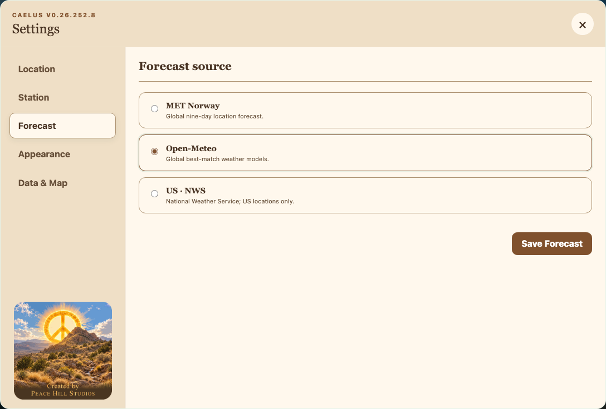

Choose one provider, then select **Save Forecast**:

- **MET Norway**: global location forecast.
- **Open-Meteo**: global best-match weather models.
- **US · NWS**: National Weather Service data for US locations only.

Forecast requests send the saved latitude and longitude to the selected provider. All provider responses are normalized into the same dashboard layout.

### Appearance

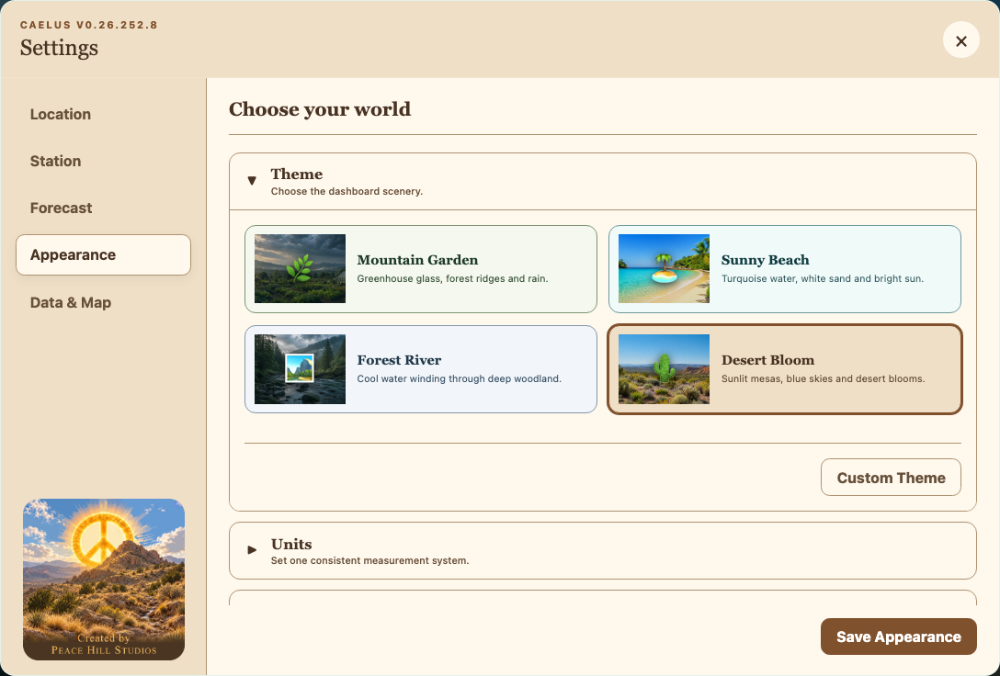

The appearance pane contains three expandable sections:

- **Theme**: Mountain Garden, Sunny Beach, Forest River, Desert Bloom, or a custom image theme. Selecting any theme previews it immediately; **Save Appearance** makes it persistent.
- **Units**: Imperial (`°F`, mph, inHg, inches) or Metric (`°C`, km/h, hPa, millimetres).
- **Display Style**: set all metric cards to one initial style, then adjust individual exceptions.

Changing units, scenery, or card style does not modify the underlying weather history.

#### Create a Custom Theme

Select **Custom Theme** at the bottom of the expanded Theme section to open the creator.

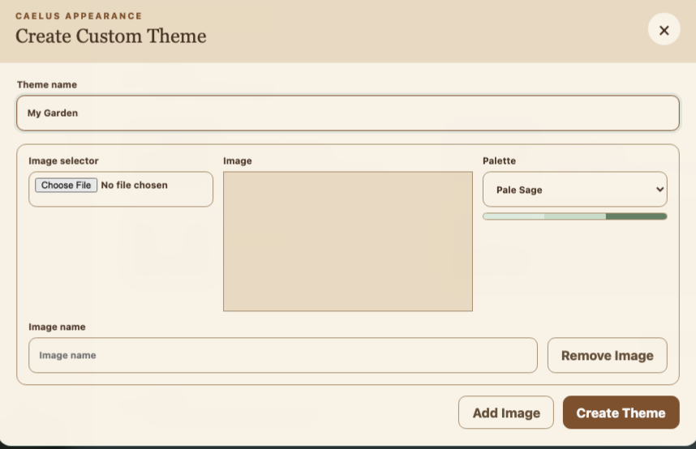

1. Enter a collection name, such as **My Garden**.
2. Choose an image, give it a display name, and select a palette. The palette controls the preview accents and is limited to Caelus's tested, readable choices.
3. Select **Add Image** to add more image choices to the same collection. A collection can contain one to five images, and each image can use a different palette.
4. Select **Create Theme**. Caelus validates and processes every image, then adds the collection to **Appearance > Theme**.
5. Select one of the new image cards and choose **Save Appearance** to make it the active dashboard theme.

Custom Theme image requirements:

- WebP, JPEG, or PNG format.
- Static images only; animated images are rejected.
- At least 320 x 180 pixels and no more than 20 million pixels.
- No more than 5 MB per image.
- A 16:9 image at 1920 x 1080 is recommended. Other aspect ratios are center-cropped.
- Theme and image names are required and may contain up to 60 characters.
- Every image must use one of the eight supplied palettes: Pale Sage, Pale Earth, Pale Water, Pale Sky, Pale Blossom, Pale Fruit, Warm Neutral, or Cool Neutral.

Caelus converts accepted images to 1920 x 1080 WebP files and creates 480 x 270 WebP thumbnails. On a standard installation, the manifest is stored at `/Users/<name>/Caelus/data/theme_settings/themes.json` on macOS, `/home/<name>/Caelus/data/theme_settings/themes.json` on Linux or Raspberry Pi, or `C:\Users\<name>\Caelus\data\theme_settings\themes.json` on Windows. Processed images are stored beside it under the absolute `data/theme_assets` path for that installation. Back up the entire installed `data` directory to preserve custom themes with settings and history.

Select **Delete** beside a collection to remove that collection and its generated images. If the deleted collection is active, Caelus immediately falls back to Mountain Garden and saves that fallback. Deletion cannot be undone except by restoring a backup or recreating the theme.

### Data & Map

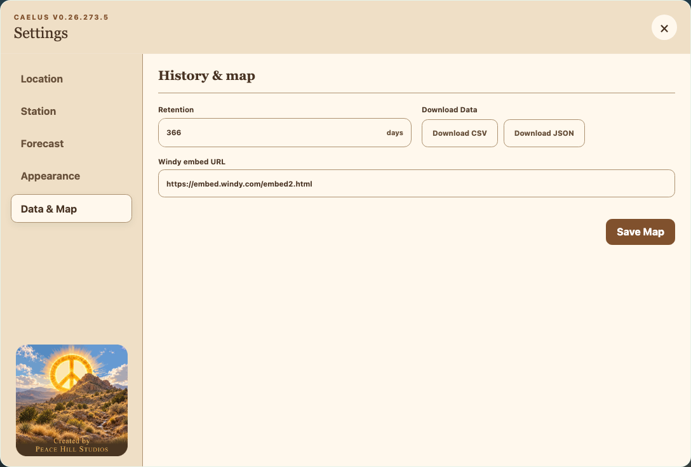

- **Retention** accepts 30 to 366 elapsed days. Successful gateway polls prune readings older than this window.
- **Download Data** contains **Download CSV** and **Download JSON** buttons. Select a format to download observations in the saved retention window. CSV is intended for spreadsheets; JSON provides a machine-readable object structure. There is no default-format selector.
- **Windy embed URL** must remain the supported secure endpoint: `https://embed.windy.com/embed2.html`. Caelus adds the saved station coordinates and marker when it builds the displayed URL.

Select **Save Map** to apply changes to retention and the Windy embed URL. Download buttons start an export immediately; they do not save pending settings changes. Save a changed retention value before downloading if you want that new window applied.

## Dashboard Overview

On a wide screen, the first row contains **Current readings**, **Today’s forecast**, and **Sunlight today**. The next row places **Regional radar** on the left and **Lunar Calendar** on the right in equal-width tiles. Together they span the same width as the four-column **24-hour sensor metrics** rows below. Narrow screens stack the tiles vertically.

Exports are available under **Settings > Data & Map > Download Data**; there is no separate Weather Archive tile.

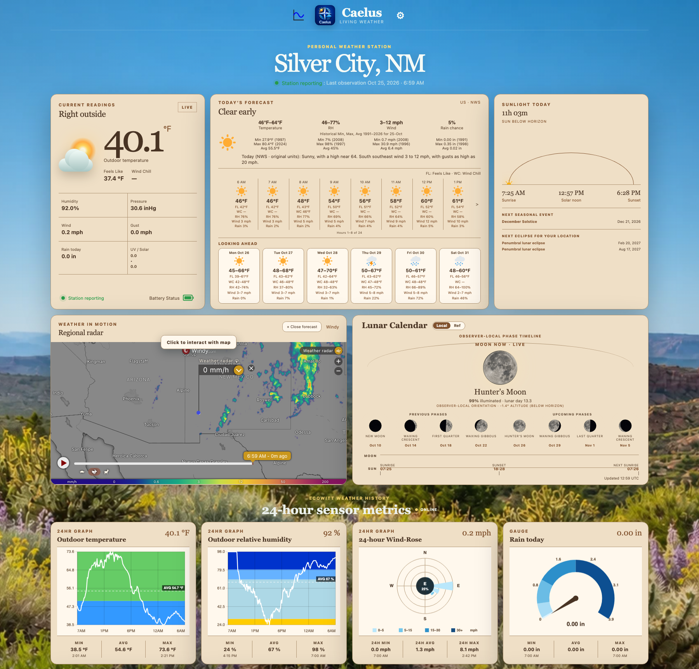

The overview shows the first sensor row; additional sensor rows continue below. [View the full dashboard](screenshots/dashboard-full.png), which ends after Sensor Metrics without a Weather Archive tile.

### Current Readings

The **Current readings** card shows the latest outdoor temperature and a compact summary of outdoor humidity, relative pressure, wind, gust, rain today, UV, and solar radiation. A dash means a required reading is unavailable or the conditions are outside a derived metric’s applicable range.

Below the outdoor temperature:

- **Feels Like** estimates how the air feels using temperature, relative humidity, and wind, assuming shade. It can be cooler or warmer than the measured temperature.
- **Wind Chill** estimates the cooling effect of wind in cold weather. It is shown only at temperatures of 50°F (10°C) or below with wind above 3 mph (about 4.8 km/h); otherwise it shows a dash.

Both values are calculated locally and saved with each new station observation.

Values are displayed in the unit system selected under **Settings > Appearance > Units**. Changing units changes presentation only; stored readings are not rewritten.

### Today’s Forecast

The compact forecast card shows today’s condition, temperature, humidity and wind ranges, precipitation chance, historical comparisons, a forecast synopsis when available, up to 24 hourly samples, and six future daily summaries. Use the arrow at the right of the hourly row to page through later hours.

Hourly forecast samples include **FL** (Feels Like) and **WC** (Wind Chill), calculated from the provider’s predicted conditions. Daily cards show their minimum–maximum ranges; Wind Chill ranges include only periods where the calculation applies. A legend above the hourly row explains the abbreviations.

Each daily card also shows the date, weather glyph, minimum–maximum temperature, minimum–maximum relative humidity (RH), precipitation chance, and minimum–maximum wind speed. Temperature and wind use your selected units. A dash means required forecast data is missing or the calculation does not apply. On mobile, the six cards wrap into two rows.

The provider label identifies the active forecast source. When a provider is temporarily unavailable, Caelus preserves and labels the last good cached forecast rather than replacing it with an empty result.

### Sunlight and Seasonal Information

The **Sunlight today** card uses the saved coordinates and timezone. Sunrise, solar noon, sunset, daylight duration, and the daylight track come from the same local-date calculation. It also shows the next seasonal event and locally visible eclipse information when the astronomy data package is available.

If eclipse calculations are unavailable, rerun the Caelus installer so the packaged astronomy data is installed in the Caelus runtime.

### Regional Radar

The Windy map is centered on the saved station coordinates and starts with its interaction guard enabled so normal page scrolling is not captured accidentally.

1. Select **Click to interact with map** before panning, zooming, or opening a Windy forecast.
2. Move the pointer away from the map or press Escape to restore the scroll guard.
3. Select **Close forecast** above the map to close an open Windy forecast panel and return to the station-centered radar view.

Windy is a separate cross-origin service. Caelus cannot directly operate the controls inside its forecast panel.

### Lunar Calendar

The **Lunar Calendar** tile sits to the right of the Windy map on wide screens. The live Moon appears above two groups showing the four previous and four upcoming phases. The live disk is calculated for the saved observer location: illumination, lunar age, altitude, bright-limb direction, and lunar-surface rotation reflect the local sky instead of a fixed phase icon. Choose **Local** for that observer-local view or **Ref** for a conventional upright phase diagram. The Sun and Moon rows share a sunrise-to-next-sunrise scale, placing sunset, moonrise, and moonset in chronological context.

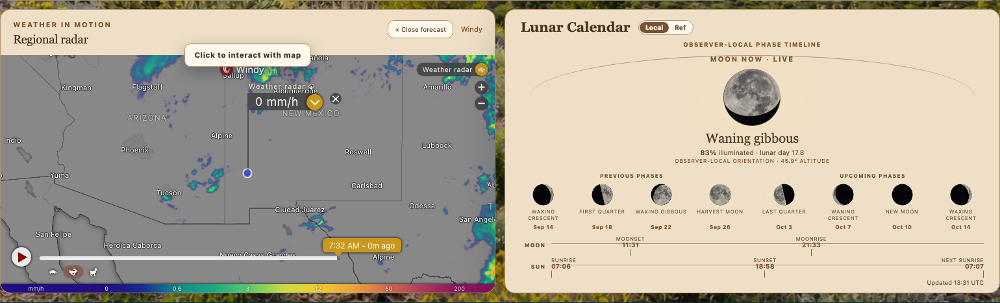

### 24-Hour Sensor Metrics

The **24-hour sensor metrics** section shows every metric that has valid stored data. The first four cards are visible initially. Select the triangle beside the section title to reveal or hide the remaining metrics.

Each card includes the current value and the minimum, average, and maximum calculated from the complete 24-hour window. Minimum and maximum timestamps use the configured local timezone.

**Outdoor VPD** (vapor pressure deficit) is calculated from outdoor temperature
and relative humidity recorded together. It uses the Sensorius saturation-pressure
formula: `VPD = 0.61078 × 10^(7.5 × T / (237.3 + T)) × (1 − RH/100)`,
where `T` is in °C. Values remain in kPa with either display unit system. Missing
or invalid inputs are skipped. The card supports both history graphs and a gauge,
and appears in Display Style settings and the full-screen graph selector.
Its Sensorius color boundaries are 0.4, 0.8, 1.2, and 1.6 kPa; the gauge spans
0–5 kPa. Calculated readings above 5 kPa remain available in history graphs and
statistics, while the gauge needle stops at its upper limit.

A card can display:

- **24Hr Graph**: stored readings for the last 24 hours.
- **6Hr Graph**: stored readings for the last six hours.
- **Gauge**: the current value on that metric’s display scale.

Gauges and graph backgrounds share fixed color zones. Temperature and dew point
use blue, green, yellow, and red bands; relative humidity uses dry-to-wet bands.
Pressure uses light blue, while rain keeps its graduated blue bands. Thresholds
convert with the selected units. Graph traces and dashed averages are white.

Select a metric card to cycle its current view. To make the starting style persistent, use **Settings > Appearance > Display Style**.

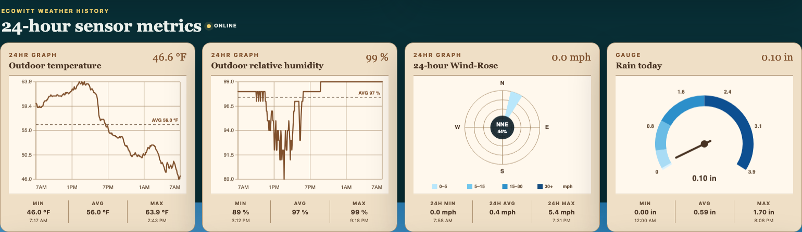

## Caelus Graphum

Select the **Graph glyph** to the left of the Caelus title to open the full-screen history graph.

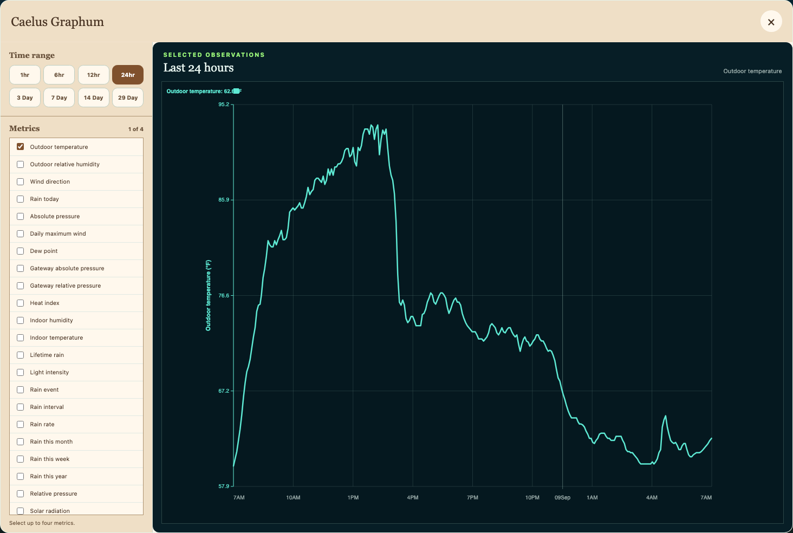

Horizontal grid lines appear when a single metric is graphed. With multiple metrics, those horizontal lines are omitted. Every station-local day boundary has a vertical line and a date tick in `ddmmm` format, such as `09Sep`.

A single metric uses its color-zone background and a white trace. Multiple
metrics retain distinct line colors on a shared neutral background.

Choose a time window of 1, 6, 12, or 24 hours, or 3, 7, 14, or 29 days. Select up to four metrics. Caelus gives each selected measurement an independently labeled scale so values with different units can be compared over the same time period.

The available list contains only metric types Caelus knows how to normalize; a selected metric can still have gaps when the gateway did not report it. Close the graph with the **X** button or Escape.

## Mobile Operation

**Mobile access is available only while your phone is connected to the same local area network (LAN) as the Caelus host. Cellular data or Wi-Fi on another network will not provide access. Adding Caelus to the Home Screen does not make it available remotely or offline.**

Connect the phone to that LAN's Wi-Fi, then open Caelus in its browser or from the Home Screen icon. Leave Caelus running on the host. Use the host's network address, such as `http://samhain.local:8767`; `127.0.0.1` on the phone refers to the phone itself.

<table class="mobile-screenshots">
  <tr><th>Mobile dashboard</th><th>Mobile settings</th></tr>
  <tr>
    <td>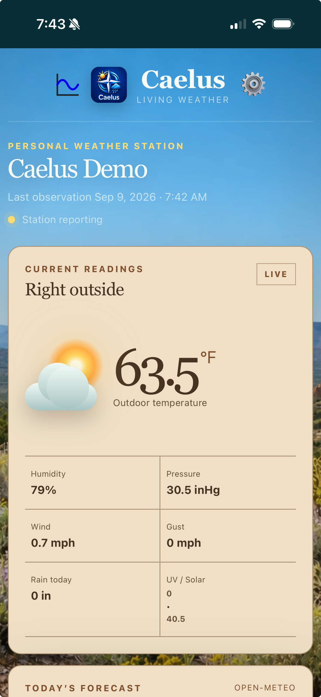</td>
    <td>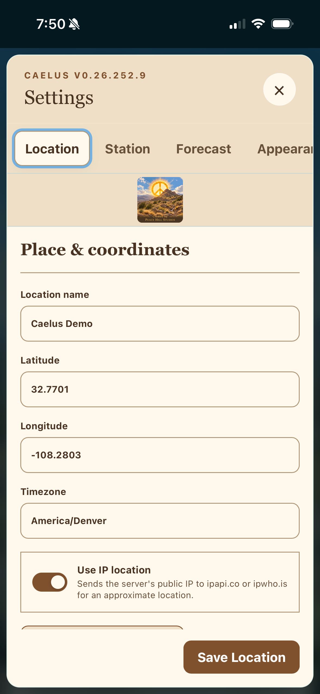</td>
  </tr>
</table>

### Dashboard and Refresh

- **Scroll vertically** to move through current readings, forecasts, sunlight, the map, the lunar calendar, and sensor metrics. The dashboard stacks its cards to fit a narrow screen.
- **Tap the Caelus icon or title** to reload the dashboard. Use this to pick up a location, forecast source, or other setting changed on another device, without closing or restarting the web app. Readings also refresh automatically while the dashboard is active.
- **Tap the Graph glyph** to the left of the title to open Caelus Graphum. Choose a time range and up to four metrics; tap **X** to return to the dashboard.
- **Tap a sensor card** to cycle its graph or gauge view. Use the triangle beside **24-hour sensor metrics** to show or hide additional cards.
- **Tap Click to interact with map** before panning or zooming Windy. Use **Close forecast** above the map to reset an open Windy forecast panel.

### Mobile Settings

1. Tap the **Settings gear** to the right of the title. Settings opens on **Location**, with the Caelus version shown at the top.
2. Swipe the **menu row horizontally** to reach Station, Forecast, Appearance, and Data & Map. Tap a menu choice to open its pane.
3. Scroll **within the pane** to reach its fields and controls. Edit the values, then tap that pane's **Save** button. Each pane saves independently; Station uses **Find Sensors**, then **Save Gateway**.
4. Look for the confirmation or warning toast at the top center of the dialog. Messages disappear after five seconds. A successful save refreshes the dashboard and keeps the current pane open.
5. Tap the **X** at the top right to close Settings. Closing does not save pending edits, and an unsaved theme preview returns to the saved theme.

Settings belong to the Caelus host and are shared by its connected devices. After saving on the Mac or another phone, tap the **Caelus icon or title on each already-open dashboard** to display those changes there. Use this refresh control in the Home Screen web app rather than relying on a browser pull-down gesture.

## Routine Operation

- Leave Caelus running on the host computer so scheduled polling and retention continue.
- Give the gateway and Caelus computer stable LAN addresses when possible.
- Check the station-status label and last-observation time before relying on a reading.
- Treat forecast data as guidance; it is supplied by the selected external provider, not by the Ecowitt gateway.
- Back up the installed `data` directory if the local history matters. Typical paths are `/Users/<name>/Caelus/data` on macOS, `/home/<name>/Caelus/data` on Linux or Raspberry Pi, and `C:\Users\<name>\Caelus\data` on Windows.

## Troubleshooting

### The Dashboard Does Not Open

Confirm that the Caelus launcher is still running and open `http://127.0.0.1:8767` on the host. From another device, use the Caelus computer’s LAN address and confirm that both devices are on the same trusted network. A host firewall may need to allow inbound TCP port 8767.

If Caelus was installed elsewhere, use the absolute launcher path for that installation rather than a relative command.

### The Station Is Standing By or the Observation Is Old

1. Confirm that the Ecowitt gateway is powered and shows sensor data in its own interface.
2. Confirm that the gateway and Caelus computer are on the same LAN.
3. Open **Settings > Station** and verify the gateway’s current base URL.
4. Select **Find Sensors** and review the reported model and inventory.
5. Select **Save Gateway** after a successful discovery.

If the gateway received a new DHCP address, update the URL and create a DHCP reservation to prevent another change.

### Forecast, Sun, Moon, or Map Information Is Wrong

Open **Settings > Location** and verify the latitude, longitude, and timezone together. Then verify that the chosen forecast provider supports the location. The US National Weather Service option is limited to US coordinates.

### A Metric Is Missing

Caelus displays a metric only after the gateway supplies a valid value and Caelus stores it. Expand the metric section, confirm the sensor reports that measurement in the Ecowitt interface, and allow at least one successful poll. Malformed or unavailable gateway fields are skipped without stopping the poller.

### Health Check

Open `http://127.0.0.1:8767/healthz` on the Caelus computer. A healthy running poller returns HTTP 200 with `{"status":"ok"}`. A stopped, failed, or cancelled poller returns HTTP 503 with a diagnostic detail.

## Privacy and Network Safety

Caelus is intended for a trusted private LAN and does not provide its own login screen. Do not expose port 8767 directly to the public internet.

External requests can disclose:

- The server’s public IP address to the location provider when IP location is used.
- Saved latitude and longitude to the selected forecast provider.
- Saved latitude and longitude to the embedded Windy map.

Use manual coordinates and disable IP location if you do not want to use public IP-geolocation services.
